# Muxshed: the beginner's guide

This guide walks you through running a live show with Muxshed, from the first login to
going live with guests. No technical knowledge needed: follow the steps in order.

The screenshots use the made-up address `studio.example.com`. Wherever you see it,
use your own studio's address instead, e.g. `https://studio.yourname.com`.

---

## Contents

1. [The words you'll see](#1-the-words-youll-see)
2. [Logging in for the first time](#2-logging-in-for-the-first-time)
3. [Inviting a guest](#3-inviting-a-guest)
4. [What your guest sees](#4-what-your-guest-sees)
5. [Connecting OBS or another streaming app](#5-connecting-obs-or-another-streaming-app)
6. [Choosing what goes on air](#6-choosing-what-goes-on-air)
7. [Putting several people on screen (scenes)](#7-putting-several-people-on-screen-scenes)
8. [Sending the show to YouTube, Twitch, etc.](#8-sending-the-show-to-youtube-twitch-etc)
9. [Your own watch page](#9-your-own-watch-page)
10. [Keeping the server happy](#10-keeping-the-server-happy)
11. [Something's wrong](#11-somethings-wrong)

---

## 1. The words you'll see

| Word | What it means |
|------|---------------|
| **Studio** | The main control page. You run the show from here. |
| **Source** | Anything that sends video in: a guest's webcam, OBS on a laptop, a camera. |
| **Guest** | A person who joins from their web browser using a link you send them. Nothing to install. |
| **Next Up** (Preview) | The left monitor. Use it to check a shot *before* it goes on air. |
| **Program** | The right monitor. This is what your viewers see. |
| **Scene** | A layout with several sources on screen at once, e.g. two guests side by side. |
| **Destination** | Where the finished show is sent: YouTube, Twitch, Kick, etc. |
| **Channel** | Muxshed's own watch page, which you can share as a link. |
| **Go Live** | Starts sending Program to your destinations and the watch page. |

---

## 2. Logging in for the first time

1. Open your studio's address in a web browser (Chrome, Edge, Firefox or Safari).
2. The first time, you'll see **First-time setup**. Type a name for your studio (optional) and
   click the button.

   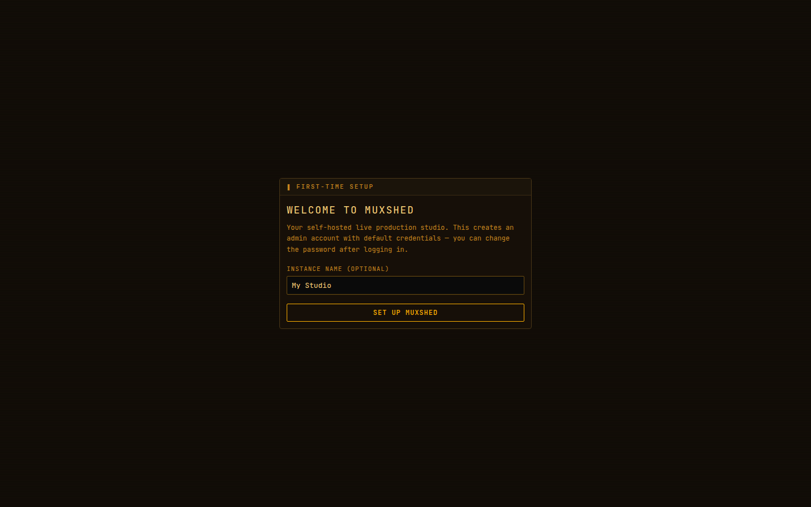

3. Muxshed shows the login details: username **admin**, password **admin**. It also shows an
   **API key**: you only need that for gadgets like a Stream Deck. If you might want one later,
   click **Copy key** and keep it somewhere safe, because it is only shown once.

   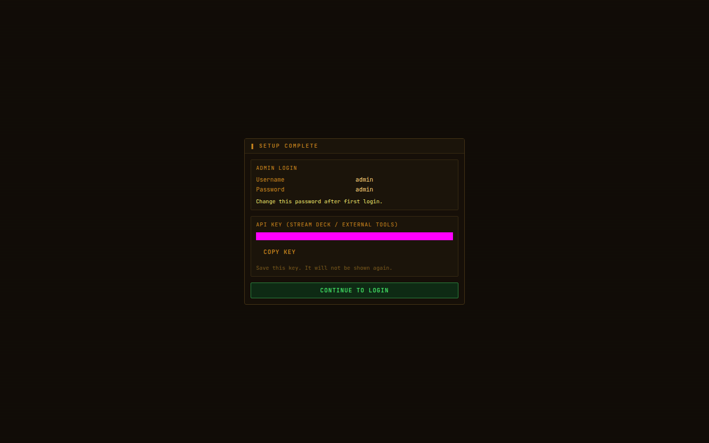

4. Click **Continue to login**, type `admin` / `admin`, and log in.

   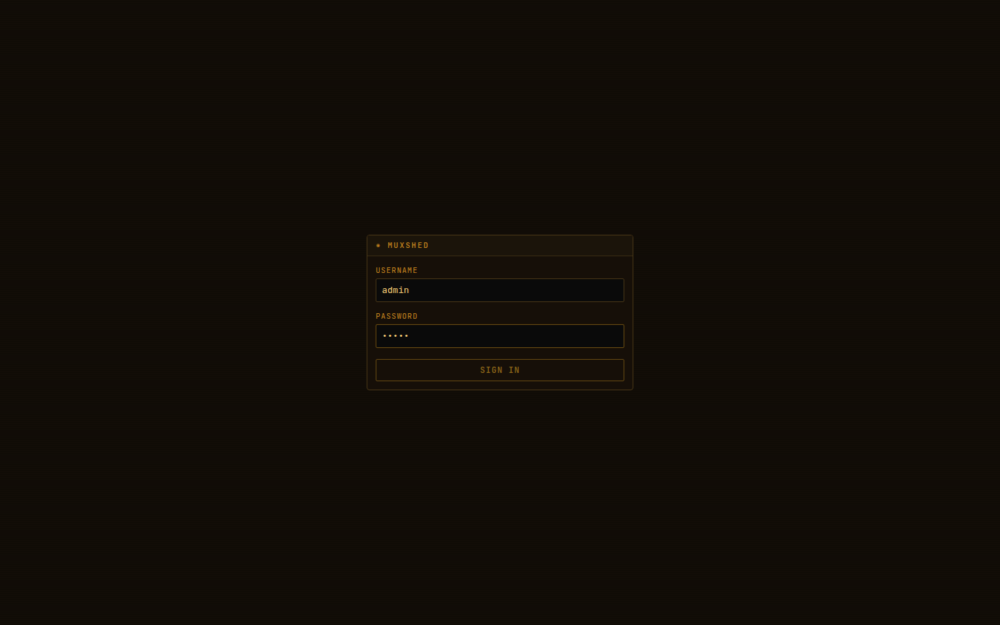

5. You're now in the **Studio**. It's empty until something is connected.

   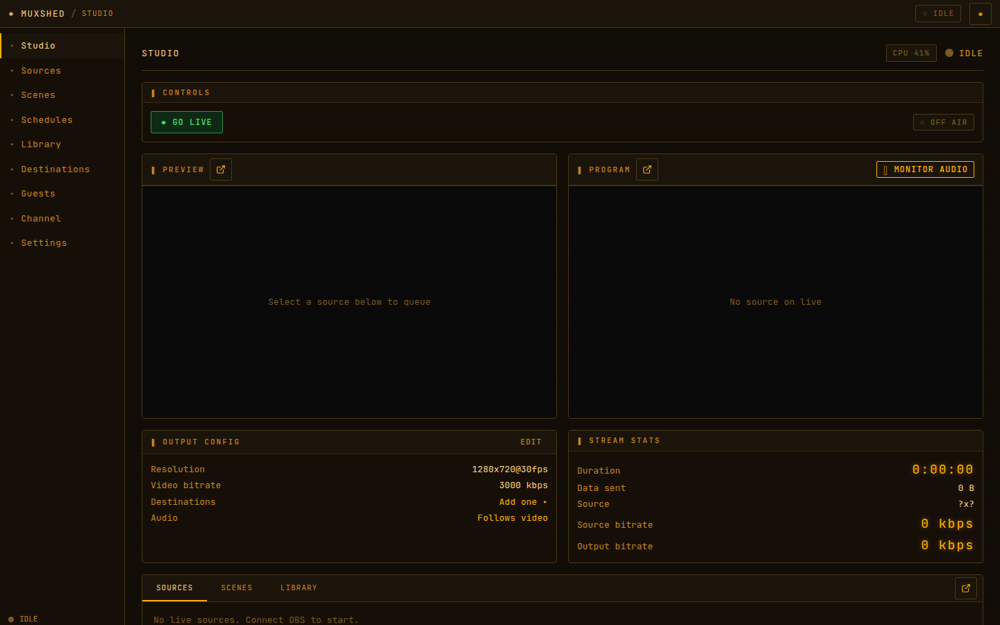

> **Do this straight away:** go to **Settings → Change password** and pick a proper password.
> Anyone who knows `admin` / `admin` could take over your show.

---

## 3. Inviting a guest

1. Click **Guests** in the left-hand menu.
2. Type the guest's name (e.g. `Jordan`) and click **Invite**.
3. Each guest gets their own link. Click **Copy link** and send it to them (email, WhatsApp,
   text message, anything).

   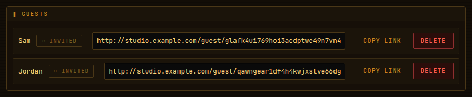

That's it. When the guest opens the link and joins, they appear in the Studio automatically
as **Jordan (guest)**.

**A message you can copy and send to your guest:**

> Hi! Here's your link for the show: *(paste link)*
> Open it in Chrome, Edge or Safari on a laptop or phone. When it asks, allow the camera and
> microphone. Check you look and sound OK, then press **Join the broadcast**.
> Headphones help stop echo. If your connection drops, leave the page open, because it
> reconnects by itself.

**Good to know**

- Each link belongs to one person. Don't share one link between two guests.
- A guest can leave and rejoin with the same link. They come back in the same spot,
  including in any scene you've put them in.
- To stop someone using their link, click **Delete** next to their name.

---

## 4. What your guest sees

When your guest opens the link, they get a "green room" where they can check themselves first:

- choose which **camera** and **microphone** to use
- **blur** their background if they want
- turn their camera or mic off and on
- watch the **mic level** bar move when they speak

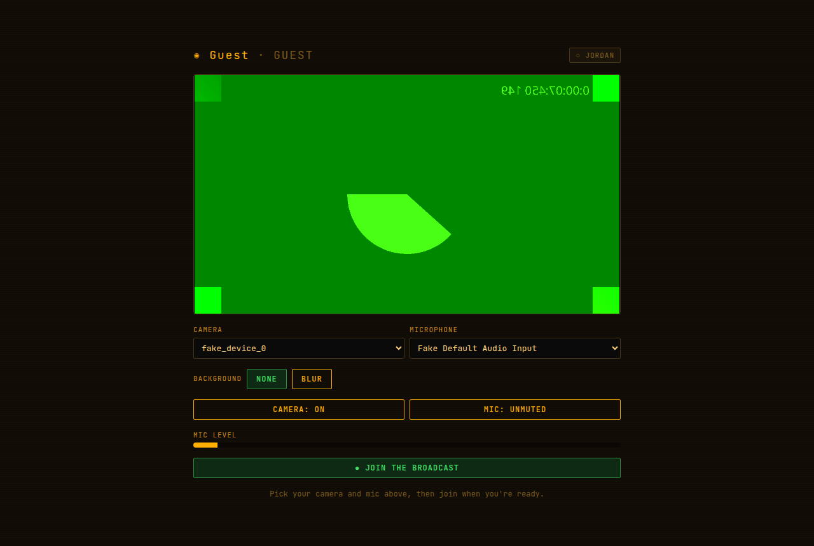

When they press **● Join the broadcast**, the badge in the top corner turns to **● ON AIR**
and they see *"You are live in the studio."*

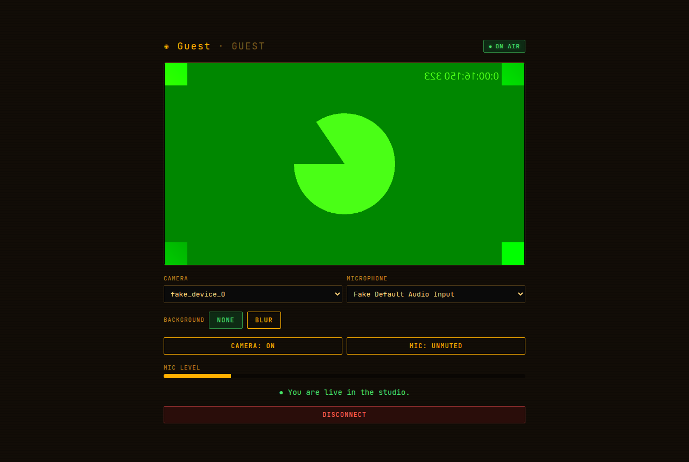

> "On air" here means **connected to your studio**. Viewers only see the guest once you put
> them on Program (see [section 6](#6-choosing-what-goes-on-air)).

If the guest's internet drops, their page shows **○ reconnecting** and tries again by itself.
They don't need to do anything. If it keeps failing, they can press **Leave** (or **Disconnect**)
and open the link again.

---

## 5. Connecting OBS or another streaming app

Use this if someone is streaming from OBS, vMix, a hardware encoder, a phone app and so on.

1. Click **Sources** in the left-hand menu.
2. Pick a **protocol** (see below), give the source a name, and click **+ Add Source**.

   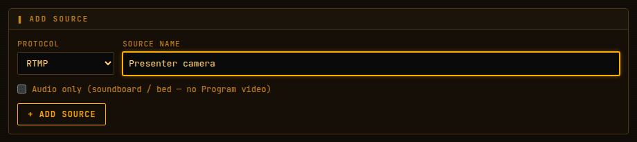

3. The new source appears as a card with the connection details.

### RTMP (works with almost everything)

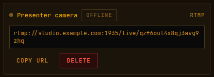

The card shows one long address. Most apps want it split into two boxes:

| In OBS (Settings → Stream) | What to put |
|----------------------------|-------------|
| Service | **Custom…** |
| Server | everything up to and including `/live`, e.g. `rtmp://studio.example.com:1935/live` |
| Stream Key | the part after `/live/`, e.g. `6g0901tu2utetvo5ufx9` |

Then click **Start Streaming** in OBS. After a few seconds, the card's badge changes from
**OFFLINE** to live and the source appears in the Studio.

Good OBS settings: 30 fps, keyframe interval **2 seconds**, video bitrate around 3000–4500 kbps.

### WHIP (lowest delay, OBS 30 or newer)

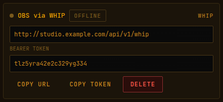

| In OBS (Settings → Stream) | What to put |
|----------------------------|-------------|
| Service | **WHIP** |
| Server | the address on the card (**Copy URL**) |
| Bearer Token | the token on the card (**Copy Token**) |

### SRT (best over bad connections, e.g. mobile)

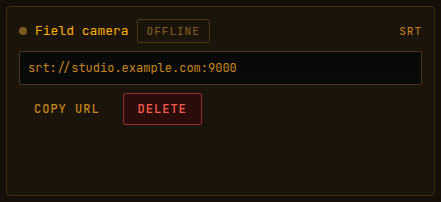

Copy the address from the card into your app's SRT or "server" box. Each SRT source has its own
port number (9000, 9001 and so on). Your server must allow that port through its firewall.

---

## 6. Choosing what goes on air

Everything that's connected appears at the bottom of the **Studio** with a small live picture.

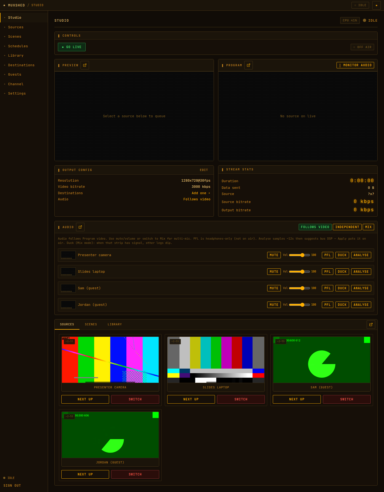

Each source has two buttons:

- **Next Up** puts it on the left monitor (**Preview**) so you can check it. Viewers don't see this.
- **Switch** puts it straight on **Program**, which is what viewers see.

The safe way to change shots:

1. Click **Next Up** on the source you want next. Check it in Preview.

   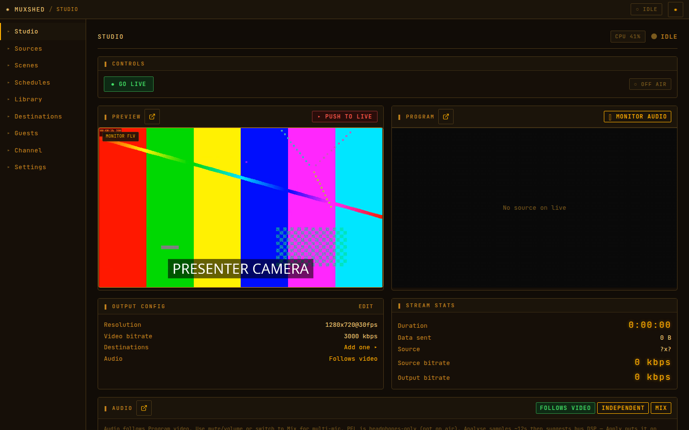

2. When you're happy, click **▸ Push to Live**. It moves to Program.

   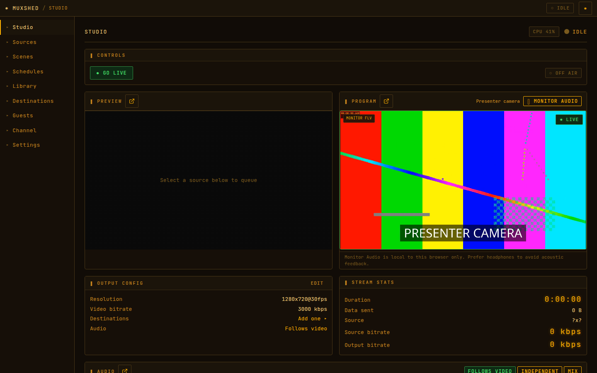

To hear what's on air in your own browser, click **Monitor audio** on the Program monitor
(wear headphones, or you'll get feedback).

---

## 7. Putting several people on screen (scenes)

A scene lets you show, for example, two guests side by side.

1. Click **Scenes** in the left-hand menu.
2. Type a name (e.g. `Interview`) and click **+ Create scene**.
3. Click the scene. Under **Add layer**, pick a source and click **+ Add Layer**. Do the same for
   the next person.
4. Drag the boxes on the black canvas to move them, and drag their bottom-right corner to resize.
   **Cover** fills the box (it may trim the edges); **Contain** shows the whole picture.

   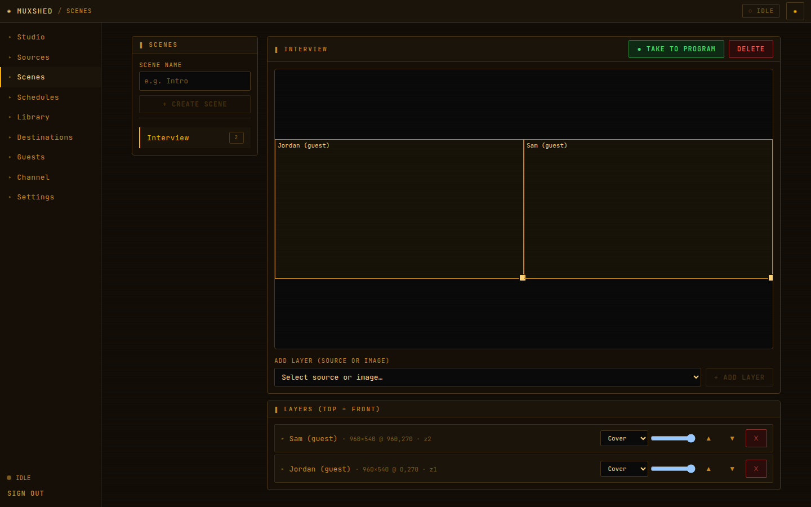

5. To put the scene on air, click **● Take to Program** here, or in the Studio open the **Scenes**
   tab and click **Take to Program**.

   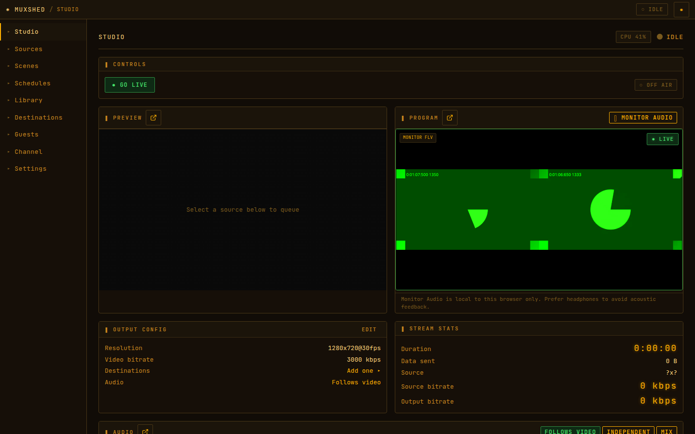

> Each scene with more than one person needs a lot of computer power. Keep it to the people
> you actually need on screen (see [section 10](#10-keeping-the-server-happy)).

If a guest in the scene on air drops out and comes back, the scene picks them up again by itself.

---

## 8. Sending the show to YouTube, Twitch, etc.

1. Get your **stream key** from the platform:
   - **YouTube:** YouTube Studio → *Go live* → *Stream* → copy the **Stream key**.
   - **Twitch:** Creator Dashboard → *Settings* → *Stream* → copy the **Primary Stream key**.
2. In Muxshed, click **Destinations**.
3. Type a name, choose the **Platform** (the address fills in by itself), and paste the
   **stream key**.

   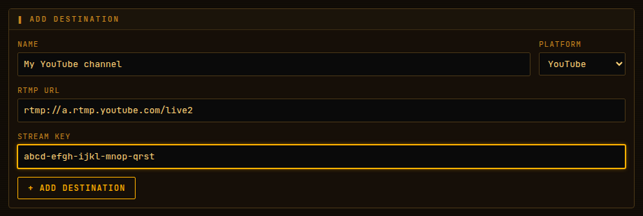

4. Click **+ Add Destination**.
5. Back in the **Studio**, pick what you want on Program, then click **● Go Live**.
   The badge changes to **● ON AIR**.
6. When the show's over, click **■ End Stream**.

> Treat stream keys like passwords. Anyone with your key can broadcast on your channel.

You can add several destinations. Ticks next to them under **Output config → Destinations**
in the Studio choose which ones are used.

---

## 9. Your own watch page

Muxshed can host a simple watch page for viewers, with no YouTube needed.

1. Click **Channel**.
2. Click **OFF** so it turns **ON**.
3. Optional: set a title, colour and logo, and a viewer password.
4. Copy the **Watch URL** and share it.

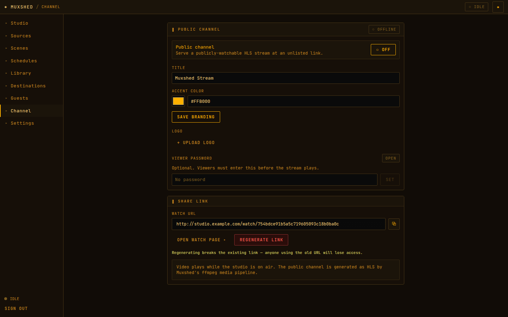

The video plays while the Studio is **on air** (after you click **Go Live**).
**Regenerate link** makes a new address and stops the old one from working.

---

## 10. Keeping the server happy

Every guest and every multi-person scene makes the server work hard. If it can't keep up,
the show stutters or freezes. Muxshed tells you before that happens.

### The CPU badge

In the Studio's top-right corner there's a **CPU** badge showing how busy the server is:

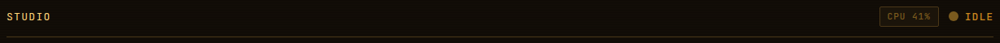

- **Grey:** fine.
- **Yellow** (75% or more): busy. Don't add more guests or scenes.
- **Red** (90% or more): overloaded.

### The overload warning

If the server stays overloaded, or a guest or scene can't keep up, a red banner appears:

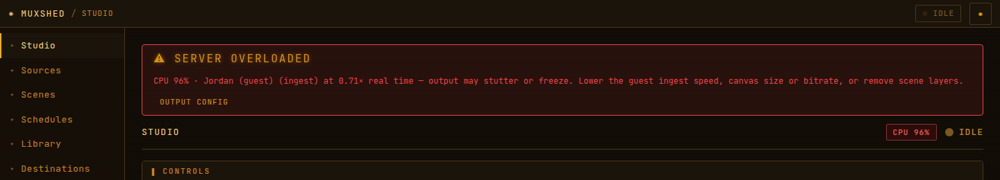

It tells you which guest or scene is struggling ("0.71× real time" means it's only managing
71% of normal speed). Click **Output config** in the banner and do one or more of these:

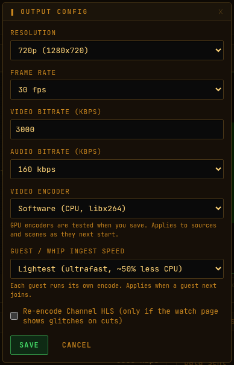

| Change | Effect |
|--------|--------|
| **Resolution → 720p** | Roughly halves the work for everything. Recommended on a server without a graphics card. |
| **Guest / WHIP ingest speed → Lightest** | Each guest costs about half as much. Takes effect when the guest next joins. |
| **Video bitrate** lower (e.g. 3000) | Slightly less work, and helps viewers with slow internet. |
| **Video encoder** | Only change this if your server has a graphics card that has been set up for it. Muxshed tests it when you click Save and tells you if it doesn't work. |

You can also take a scene off air, or remove a layer, to free up power straight away.

---

## 11. Something's wrong

| Problem | Try this |
|---------|----------|
| Guest says the camera doesn't work | The studio address must start with **https://**. Ask them to allow the camera in the browser (padlock icon next to the address), and to close other apps that use the camera (Zoom, Teams). |
| Guest stuck on "connecting" | Their network may block video calls. Ask them to try another network (e.g. phone hotspot). If it happens a lot, set up a TURN relay under **Guests → Connectivity**. |
| Guest shows **○ reconnecting** | Their internet blipped. Wait. It recovers by itself, usually within a few seconds. |
| Guest connected but not in the Studio | Wait 5 seconds. If they still don't appear, ask them to press **Disconnect** and open the link again. |
| OBS won't connect (RTMP) | Check the Server box ends in `/live` and the Stream Key has no spaces. Check port **1935** is open on the server. |
| Program is black | Check the source shows as live on its card. Click **Next Up** then **Push to Live** again. |
| Picture stutters or freezes | Look for the **CPU** badge or the overload banner, and see [section 10](#10-keeping-the-server-happy). |
| Viewers hear echo | Someone has speakers on near a mic. Ask guests to wear headphones. Only use **Monitor audio** with headphones. |
| Forgot the admin password | Ask whoever runs the server to reset it. |
